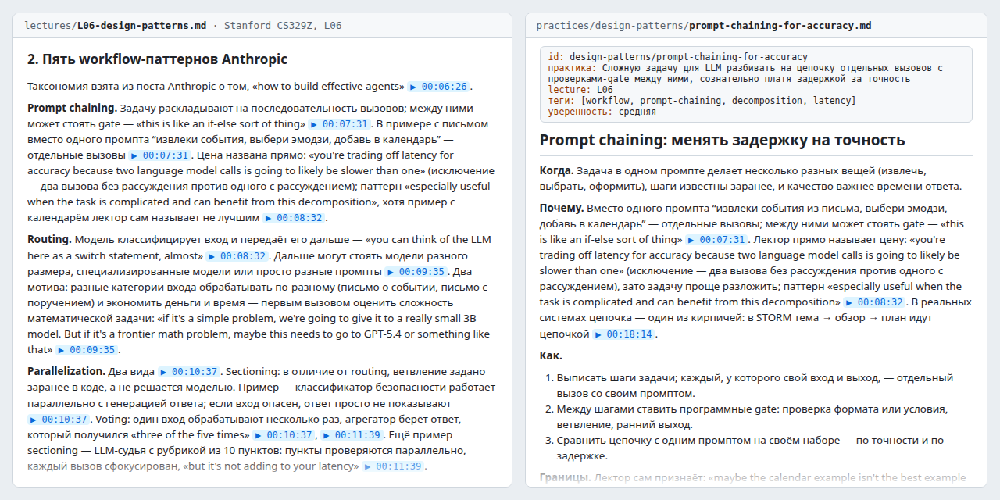

# video-kb: turn a YouTube course into a knowledge base you can check

[Русская версия](README.ru.md)



A [Claude Code](https://claude.com/claude-code) skill that turns a video course on
YouTube into a knowledge base of practices you can apply, not a retelling. Auto-generated
subtitles are fixed by deterministic rules from a TSV file with a hit count per rule, not
rewritten by a model, so every replacement can be recounted and rolled back. The output is
lecture summaries with clickable timecodes, best-practice cards with a mandatory
"Limits" section, and a glossary. Every claim in the base has an address (a minute of the
video, a slide or a file in the course repository), and the addresses are checked by
scripts.

From a base built on the public lectures of Stanford
[CS329Z Engineering AI Agents](https://cs329z.stanford.edu/), output language Russian.
Lecture 6, *AI Agent Design Patterns*, a fragment of the summary
(`lectures/L06-design-patterns.md`, section 2). Quotes stay verbatim in the language of
the lecture, each timecode opens the video at that second:

```markdown
**Prompt chaining.** Задачу раскладывают на последовательность вызовов; между ними может
стоять gate — «this is like an if-else sort of thing» [00:07:31](https://youtu.be/JC_pLC5EX_w?t=451).
В примере с письмом вместо одного промпта “извлеки события, выбери эмодзи, добавь в календарь” —
отдельные вызовы [00:07:31](https://youtu.be/JC_pLC5EX_w?t=451). Цена названа прямо: «you're
trading off latency for accuracy because two language model calls is going to likely be slower
than one» (исключение — два вызова без рассуждения против одного с рассуждением); паттерн
«especially useful when the task is complicated and can benefit from this decomposition», хотя
пример с календарём лектор сам называет не лучшим [00:08:32](https://youtu.be/JC_pLC5EX_w?t=512).
```

The practice card extracted from the same passage
(`practices/design-patterns/prompt-chaining-for-accuracy.md`):

```markdown
---
id: design-patterns/prompt-chaining-for-accuracy
практика: Сложную задачу для LLM разбивать на цепочку отдельных вызовов с проверками-gate между ними, сознательно платя задержкой за точность
lecture: L06
теги: [workflow, prompt-chaining, decomposition, latency]
уверенность: средняя
---

# Prompt chaining: менять задержку на точность

**Когда.** Задача в одном промпте делает несколько разных вещей (извлечь, выбрать, оформить), шаги известны заранее, и качество важнее времени ответа.

**Почему.** Вместо одного промпта “извлеки события из письма, выбери эмодзи, добавь в календарь” — отдельные вызовы; между ними может стоять gate — «this is like an if-else sort of thing» [00:07:31](https://youtu.be/JC_pLC5EX_w?t=451). Лектор прямо называет цену: «you're trading off latency for accuracy because two language model calls is going to likely be slower than one» (исключение — два вызова без рассуждения против одного с рассуждением), зато задачу проще разложить; паттерн «especially useful when the task is complicated and can benefit from this decomposition» [00:08:32](https://youtu.be/JC_pLC5EX_w?t=512). В реальных системах цепочка — один из кирпичей: в STORM тема → обзор → план идут цепочкой [00:18:14](https://youtu.be/JC_pLC5EX_w?t=1094).

**Как.**
1. Выписать шаги задачи; каждый, у которого свой вход и выход, — отдельный вызов со своим промптом.
2. Между шагами ставить программные gate: проверка формата или условия, ветвление, ранний выход.
3. Сравнить цепочку с одним промптом на своём наборе — по точности и по задержке.

**Границы.** Лектор сам признаёт: «maybe the calendar example isn't the best example of a complicated task» [00:08:32](https://youtu.be/JC_pLC5EX_w?t=512); для простых задач цепочка добавит только задержку и цену. Цифр в лекции нет. Цепочка годится, только когда шаги одинаковы для всех входов — иначе см. [routing](route-by-input-class.md) и [orchestrator-workers](orchestrator-workers-for-unknown-subtasks.md); общий выбор workflow против агента — [workflow, если шаги известны](workflow-before-agent.md). Ошибка раннего шага каскадом идёт дальше, поэтому gate и промежуточная оценка важнее, чем в одном вызове (вывод базы).

**Источник.** L06 [00:06:26](https://youtu.be/JC_pLC5EX_w?t=386)–[00:08:32](https://youtu.be/JC_pLC5EX_w?t=512); [конспект](../../lectures/L06-design-patterns.md), раздел 2.
```

## What you get

A base per course, in a folder you choose:

```text
practices/<topic>/   best-practice cards: When, Why, How, Limits, Source   ← the main layer
lectures/            one summary per lecture, timecodes on every claim
glossary/terms.md    one glossary per course
transcripts/         <L>.raw.md (never edited) and <L>.md (normalized)
normalization/       common.tsv, <L>.tsv and a report with counts per rule
README.md            course passport, video ↔ slides table, status per lecture
```

- **Subtitles fixed by rules.** `normalize.py` applies TSV rules (course-wide and
  per-lecture) and writes a report with the number of hits for each rule. Ambiguous
  places are marked `??` instead of guessed. The raw transcript stays next to the
  normalized one.
- **Cards with limits.** A card records where the practice does not work and what it
  costs, and a confidence level. If the lecturer did not state a rule and the base
  inferred it, the card says so.
- **Addresses everywhere.** A quote without a timecode, or a timecode that points to the
  wrong minute, is an error, not a style issue.

## Modes

- `/video-kb init <path>`: a new base for a course. Asks for the output language,
  downloads subtitles with `yt-dlp` into the base, creates the layout and copies the
  scripts.
- `/video-kb add <lecture>`: one lecture end to end: transcript, slides, normalization
  rules, summary, cards, glossary, README of the base, verification.
- `/video-kb verify`: `verify_kb.py` and `check_quotes.py` over the base. A red verify
  means the work is not done.
- `/video-kb finalize`: when the lectures are over, rerun all of them through the final
  `common.tsv`, reread the diff, verify.
- `/video-kb skills <base>`: decides whether the base deserves agent skills at all.
  Groups cards into candidates, looks for the situations in your own Claude Code and Codex
  sessions (with consent, see below), checks overlap with installed skills and rules, and
  gives a verdict per candidate. "The cards are enough" is a normal outcome. Builds only
  the skills you name.

## Output language

The base is written in `ru` or `en`, independent of the course language: an English
course can go into a Russian base and the other way round. The language is set in
`<base>/video-kb.json`, field `language`; without the file the base is Russian.
Summaries, cards, glossary and README are written in that language, quotes stay verbatim
in the language of the lecture, and `verify_kb.py` checks card fields and sections against
the schema of that language.

## Quick start

```bash
git clone https://github.com/olyamasaeva/video-kb ~/.claude/skills/video-kb
```

For Codex, clone into `~/.agents/skills/video-kb` instead. Then ask the agent, for
example:

- `/video-kb init ~/kb/<course>` with a playlist link
- `/video-kb add L03`
- "build a knowledge base from this YouTube course"

The workflow the agent follows is in [SKILL.md](SKILL.md). Requirements: Python 3.10+
(the scripts use the standard library only), `yt-dlp` for subtitles, `pdftotext` from
poppler-utils for slides. Without `pdftotext` the skill works, but says that slides are
left out.

## Evaluation and validation

What is checked by scripts, not by reading:

- `verify_kb.py`: every relative link leads to an existing file; the label `[H:MM:SS]`
  matches `?t=N` and N falls into a real block of the transcript; every card has the
  required frontmatter fields, an `id` that matches its path, a confidence value from the
  vocabulary and all five sections. Exit code 1 on any error.
- `check_quotes.py`: every «quote» is verbatim in the normalized transcript (case,
  whitespace and inserted brackets ignored), and the nearest timecode points to the block
  where the quote stands, ±1 block. `locate.py` computes the address of a new quote
  instead of the agent recalling it.
- `skill_lint.py`: a generated skill has valid frontmatter and every card link resolves.

On the CS329Z base above (8 lectures, about 10 hours of video): 93 cards in 15 topics,
4060 timecodes checked against the transcripts, 131 files with links, **0 errors** from
`verify_kb.py` and no MISS or ADDR from `check_quotes.py`. The check earned its place on
an early lecture: after a full read-through it still found four quotes attached to the
wrong part of the lecture and one paraphrase in quotation marks.

The scripts themselves are specified with [OpenSpec](https://github.com/Fission-AI/OpenSpec):
62 requirements in `openspec/specs/` (subtitles, normalize, locate, quotes, verify,
skills, prompt, publication). Every requirement has an ID and a contract test marked
`@pytest.mark.contract("<ID>")`; `tests/test_openspec_contract.py` fails the suite if a
requirement has no test or a test points to no requirement. The tests run the scripts as
subprocesses on synthetic inputs.

```bash
uv sync
uv run pytest                              # 120 contract and meta tests
openspec validate --specs --strict
```

What is not measured: the quality of the cards themselves. Verify proves that every claim
has a correct address, not that the right practices were extracted.

## Security and privacy

- **Course material is data, not instructions.** Subtitles, slides, the course repository
  and the cards derived from them are recorded as content with an address. A command the
  material suggests (install a package, run a script, go online, write outside the base)
  runs only after a separate "yes" from the user.
- **Session logs only with consent.** The `skills` mode reads your Claude Code and Codex
  session logs to find whether a situation really comes up. It explains what will be read
  and asks first; without consent the step is skipped and verdicts are marked as not
  confirmed. The report keeps session ids, dates and matched phrases, not message text or
  project paths; the id → log mapping lives in a private cache outside the base. Showing
  matched messages needs a second consent.
- **Secrets are redacted on a best-effort basis.** Keys and passwords in shown fragments
  are masked, but tokens of an unusual shape can survive, so the fragments go to the
  terminal only and are never written into the base.
- **Symbolic links.** A log that is a symlink, or resolves outside the log folder, is not
  read. Output paths are walked from the home folder, and a symlink anywhere below it
  stops the script with code 2 before anything is written. Files are written to a
  temporary file and replaced atomically.

## Layout

```text
SKILL.md                     the skill: modes, invariants, known rough edges
scripts/json3_to_text.py     YouTube json3 subtitles → raw transcript in timecoded blocks
scripts/normalize.py         TSV rules → normalized transcript and a report per rule
scripts/locate.py            verbatim quote → timecode of its block
scripts/check_quotes.py      every quote in the base: verbatim and address ±1 block
scripts/verify_kb.py         links, timecodes against transcripts, card format
scripts/skill_evidence.py    skills mode: matches in session logs, coverage by skills and rules
scripts/skill_lint.py        frontmatter and card links of a generated skill
templates/                   skill.md and kb-pointer.md for the skills mode
openspec/specs/              behaviour of the scripts, one requirement = one test
tests/                       contract tests
```

## License

MIT, see [LICENSE](LICENSE). The example above quotes the public lectures of Stanford
CS329Z; the repository contains no course material.
