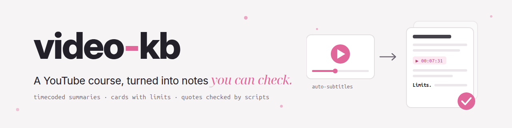
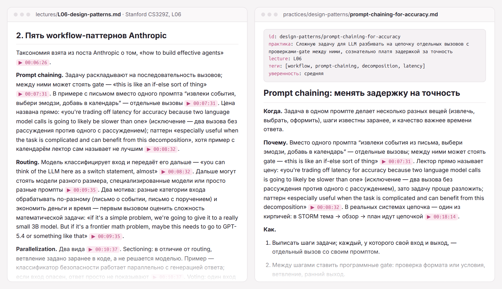
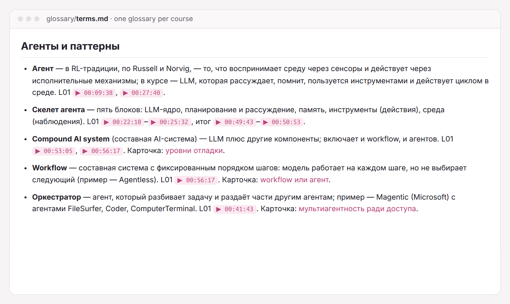
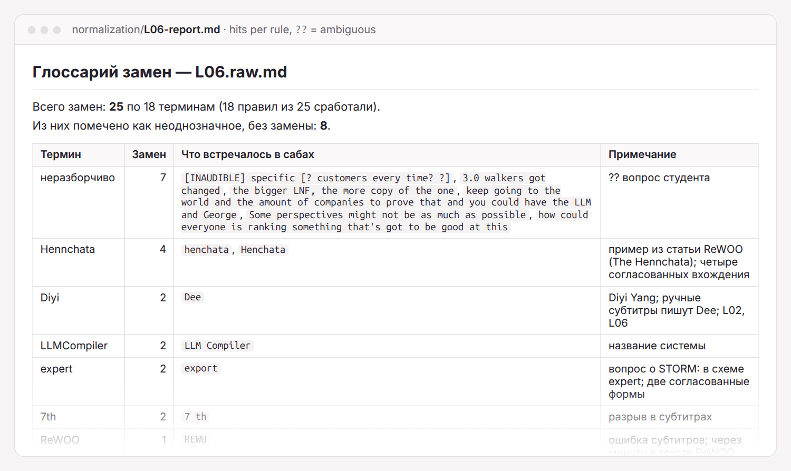
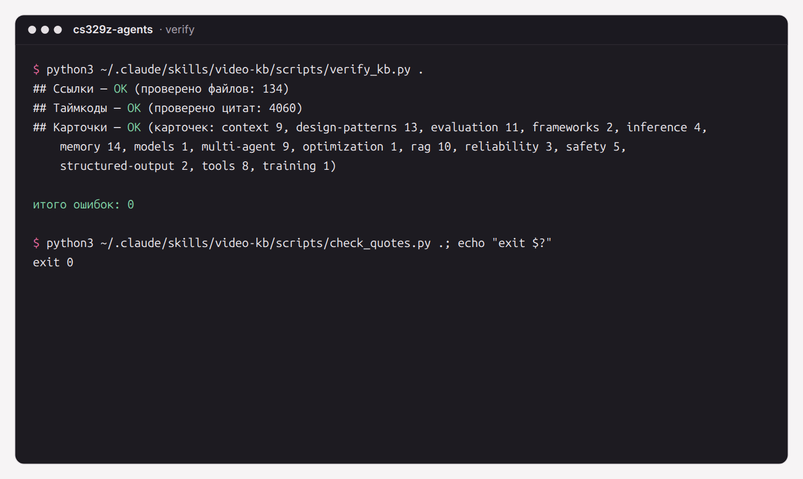
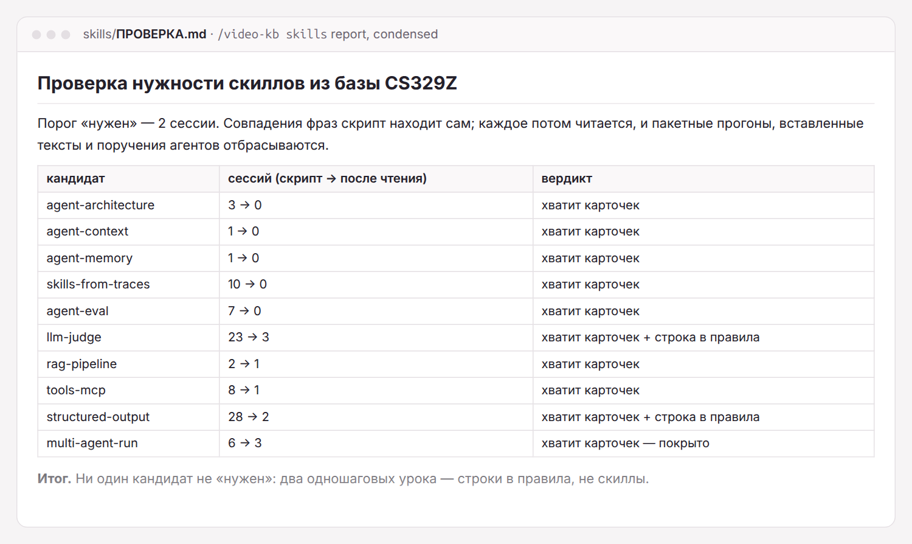

<p align="center"><a href="README.md">English</a> · <b>Русский</b></p>

<p align="center">
  <picture>
    <source media="(prefers-color-scheme: dark)" srcset="docs/img/banner-dark.png">
    
  </picture>
</p>

<p align="center">
  <a href="https://github.com/olyamasaeva/video-kb/actions/workflows/tests.yml"></a>
  <a href="LICENSE"></a>
  
  
  
</p>

<p align="center"><a href="SKILL.md"><picture><source media="(prefers-color-scheme: dark)" srcset="docs/img/btn-skill-dark.png"></picture></a>&nbsp;<a href="#quick-start"><picture><source media="(prefers-color-scheme: dark)" srcset="docs/img/btn-start-dark.png"></picture></a>&nbsp;<a href="#manual"><picture><source media="(prefers-color-scheme: dark)" srcset="docs/img/btn-manual-dark.png"></picture></a></p>

> [!NOTE]
> **Автосубтитры чинятся правилами со счётчиком замен, а не переписываются моделью, и каждую цитату и каждый таймкод базы проверяют скрипты.** На открытых лекциях Stanford CS329Z: 93 карточки практик и 4060 таймкодов, 0 ошибок `verify_kb.py`. Новое: `/video-kb skills <база>` — нужны ли из базы скиллы для агента вообще.

<h3 align="center">Курс посмотрели. А минуту, где это сказано, найдёте?</h3>

<p align="center"><b>video-kb</b> — скилл для Claude Code и Codex: видеокурс с YouTube превращается<br>в карточки практик с честными границами, конспекты с кликабельными таймкодами и словарь.</p>

<p align="center"><a href="#quick-start">Быстрый старт</a> · <a href="#why">Зачем</a> · <a href="#what-you-get">Что получаешь</a> · <a href="#not-yet">Чего пока нет</a> · <a href="#faq">Вопросы</a> · <a href="#manual">Руководство</a></p>

<a id="quick-start"></a>

## 🚀 Запуск за две минуты

```bash
git clone https://github.com/olyamasaeva/video-kb ~/.claude/skills/video-kb
```

Для Codex — в `~/.agents/skills/video-kb`. Нужны Python 3.10+ (только стандартная
библиотека), `yt-dlp` для субтитров и, для слайдов, `pdftotext` из poppler-utils.

Дальше — попросить агента:

```text
/video-kb init ~/kb/<курс>       # со ссылкой на плейлист: язык, субтитры, раскладка, скрипты
/video-kb add L03                # одна лекция целиком
/video-kb verify                 # красный verify — работа не закончена
```

или просто «собери базу знаний из этого курса на YouTube». Порядок работы агента — в
[SKILL.md](SKILL.md).

<a id="why"></a>

## 💡 Зачем я это сделала

Модель, которую попросили «законспектировать курс», пишет уверенный пересказ. Субтитры она
правит молча, и ослышка от настоящей правки ничем не отличается. Цитаты плывут: слова
близки к сказанному, минута где-то рядом. Через неделю уже не отличить, что сказал лектор, а
что добавил конспект.

Мне нужна была база, где у каждого утверждения есть адрес, который можно открыть: минута
видео, слайд или файл в репозитории курса. И где неверный адрес — ошибка, которую находит
скрипт, а не я при перечитывании.

Поэтому читает и пишет модель, а считает обычный Python: какое правило субтитров сколько раз
сработало, дословна ли цитата, ведёт ли её таймкод в тот блок, где она стоит. Проверка
окупилась на одной из первых лекций: после полного перечитывания она всё равно нашла четыре
цитаты, привязанные не к той части лекции, и один пересказ в кавычках.

<a id="what-you-get"></a>

## 🎬 На входе курс, на выходе база, которую можно проверить

Каждая лекция становится конспектом с таймкодом у каждого утверждения, а практики из неё —
карточками: когда применять, почему, как, где перестаёт работать и откуда взято. Цитаты
остаются дословными на языке лекции; сама база пишется по-русски или по-английски.

<picture><source media="(prefers-color-scheme: dark)" srcset="docs/img/shot-hero-dark.png"></picture>

| | |
|---|---|
| 🃏 **Карточки практик** | Когда, Почему, Как, Границы, Источник. Границы обязательны, есть уровень уверенности. |
| ⏱️ **Таймкоды** | Каждое утверждение ведёт на ту секунду видео, где оно сказано. |
| 🔧 **Правила субтитров** | TSV-правила со счётчиком замен; неоднозначное помечается `??`, а не угадывается. |
| 📚 **Словарь** | Один на курс, у термина — адреса объяснений и карточки. |
| ✅ **Verify** | Ссылки, таймкоды против транскриптов, формат карточек, дословность цитат. Код 1 при любой ошибке. |
| 🧩 **Режим skills** | Прежде чем делать из карточек скилл, проверяет ваши же сессии. «Хватит карточек» — нормальный ответ. |

<details>
<summary><b>Остальное из настоящей базы</b></summary>

<table>
<tr>
<td width="50%" valign="top"><picture><source media="(prefers-color-scheme: dark)" srcset="docs/img/shot-glossary-dark.png"></picture><br><b>Словарь</b> · <sub>Термины с таймкодами и ссылками на карточки.</sub></td>
<td width="50%" valign="top"><picture><source media="(prefers-color-scheme: dark)" srcset="docs/img/shot-normalization-dark.png"></picture><br><b>Отчёт нормализации</b> · <sub>Что было в субтитрах и сколько раз сработало каждое правило.</sub></td>
</tr>
<tr>
<td width="50%" valign="top"><picture><source media="(prefers-color-scheme: dark)" srcset="docs/img/shot-verify-dark.png"></picture><br><b>Verify</b> · <sub>134 файла, 4060 таймкодов, 93 карточки, 0 ошибок.</sub></td>
<td width="50%" valign="top"><picture><source media="(prefers-color-scheme: dark)" srcset="docs/img/shot-skills-dark.png"></picture><br><b>Режим skills</b> · <sub>Совпадения фраз, потом чтение: ни одному кандидату скилл не понадобился.</sub></td>
</tr>
</table>

<sub>Все скриншоты — из базы по открытым лекциям Stanford CS329Z, язык базы русский. Отчёт режима skills сокращён, id сессий в нём нет.</sub>

</details>

<a id="not-yet"></a>

## 🧭 Чего пока нет

- **Качество карточек не оценивается.** Verify доказывает, что у каждого утверждения
  верный адрес, а не что извлечены нужные практики.
- **Только субтитры YouTube.** На входе `json3` от `yt-dlp`. Своего распознавания речи нет,
  видео без субтитров не обработать.
- **Два языка базы.** База пишется на `ru` или `en`. Язык курса от него не зависит:
  английский курс можно собрать в русскую базу и наоборот.
- **Слайды — только текстом.** Слайды идут через `pdftotext`; схемы и картинки на слайдах не
  читаются. Без `pdftotext` скилл работает и предупреждает, что слайды выпали.
- **Режим skills пропускает огромные журналы.** Журнал со строкой длиннее 1 000 000 знаков
  или файл больше 256 МиБ не читается, и скан помечается неполным.

<a id="faq"></a>

## ❓ Что спрашивают первым

**Субтитры переписывает модель?**
Нет. Модель предлагает правила, `normalize.py` их применяет и считает каждую замену. Сырой
транскрипт лежит рядом с нормализованным, любую замену можно пересчитать или откатить.

**Что будет, если цитата неверна?**
`check_quotes.py` выходит с кодом 1, если «цитаты» нет в транскрипте дословно или её таймкод
дальше одного блока. Адрес новой цитаты считает `locate.py`, а не вспоминает агент.

**Нужны ли слайды или репозиторий курса?**
Нет. С ними база лучше: утверждение может сослаться на слайд или файл. Без них база
опирается только на видео.

**Читает ли он мои сессии агента?**
Только `/video-kb skills` и только после согласия. В отчёте непрозрачные id, даты и
совпавшие фразы, без текста реплик и путей проектов. Подробнее — [Безопасность и
приватность](#безопасность-и-приватность).

**Нужны ли пакеты или сеть при работе?**
Скрипты используют только стандартную библиотеку Python. Сеть нужна `yt-dlp`, чтобы скачать
субтитры.

<a id="manual"></a>

## 📖 Руководство

### Пример: один фрагмент, два слоя

Из базы по открытым лекциям Stanford
[CS329Z Engineering AI Agents](https://cs329z.stanford.edu/), язык базы — русский.
Лекция 6, *AI Agent Design Patterns*, фрагмент конспекта
(`lectures/L06-design-patterns.md`, раздел 2). Цитаты дословные, на языке лекции; каждый
таймкод открывает видео на этой секунде:

```markdown
**Prompt chaining.** Задачу раскладывают на последовательность вызовов; между ними может
стоять gate — «this is like an if-else sort of thing» [00:07:31](https://youtu.be/JC_pLC5EX_w?t=451).
В примере с письмом вместо одного промпта “извлеки события, выбери эмодзи, добавь в календарь” —
отдельные вызовы [00:07:31](https://youtu.be/JC_pLC5EX_w?t=451). Цена названа прямо: «you're
trading off latency for accuracy because two language model calls is going to likely be slower
than one» (исключение — два вызова без рассуждения против одного с рассуждением); паттерн
«especially useful when the task is complicated and can benefit from this decomposition», хотя
пример с календарём лектор сам называет не лучшим [00:08:32](https://youtu.be/JC_pLC5EX_w?t=512).
```

Карточка практики из того же места
(`practices/design-patterns/prompt-chaining-for-accuracy.md`):

```markdown
---
id: design-patterns/prompt-chaining-for-accuracy
практика: Сложную задачу для LLM разбивать на цепочку отдельных вызовов с проверками-gate между ними, сознательно платя задержкой за точность
lecture: L06
теги: [workflow, prompt-chaining, decomposition, latency]
уверенность: средняя
---

# Prompt chaining: менять задержку на точность

**Когда.** Задача в одном промпте делает несколько разных вещей (извлечь, выбрать, оформить), шаги известны заранее, и качество важнее времени ответа.

**Почему.** Вместо одного промпта “извлеки события из письма, выбери эмодзи, добавь в календарь” — отдельные вызовы; между ними может стоять gate — «this is like an if-else sort of thing» [00:07:31](https://youtu.be/JC_pLC5EX_w?t=451). Лектор прямо называет цену: «you're trading off latency for accuracy because two language model calls is going to likely be slower than one» (исключение — два вызова без рассуждения против одного с рассуждением), зато задачу проще разложить; паттерн «especially useful when the task is complicated and can benefit from this decomposition» [00:08:32](https://youtu.be/JC_pLC5EX_w?t=512). В реальных системах цепочка — один из кирпичей: в STORM тема → обзор → план идут цепочкой [00:18:14](https://youtu.be/JC_pLC5EX_w?t=1094).

**Как.**
1. Выписать шаги задачи; каждый, у которого свой вход и выход, — отдельный вызов со своим промптом.
2. Между шагами ставить программные gate: проверка формата или условия, ветвление, ранний выход.
3. Сравнить цепочку с одним промптом на своём наборе — по точности и по задержке.

**Границы.** Лектор сам признаёт: «maybe the calendar example isn't the best example of a complicated task» [00:08:32](https://youtu.be/JC_pLC5EX_w?t=512); для простых задач цепочка добавит только задержку и цену. Цифр в лекции нет. Цепочка годится, только когда шаги одинаковы для всех входов — иначе см. [routing](route-by-input-class.md) и [orchestrator-workers](orchestrator-workers-for-unknown-subtasks.md); общий выбор workflow против агента — [workflow, если шаги известны](workflow-before-agent.md). Ошибка раннего шага каскадом идёт дальше, поэтому gate и промежуточная оценка важнее, чем в одном вызове (вывод базы).

**Источник.** L06 [00:06:26](https://youtu.be/JC_pLC5EX_w?t=386)–[00:08:32](https://youtu.be/JC_pLC5EX_w?t=512); [конспект](../../lectures/L06-design-patterns.md), раздел 2.
```


### Что получаешь

Одна база на курс, в папке, которую выбираешь сам:

```text
practices/<тема>/    карточки практик: Когда, Почему, Как, Границы, Источник   ← главный слой
lectures/            конспект на лекцию, таймкод у каждого утверждения
glossary/terms.md    один словарь на курс
transcripts/         <L>.raw.md (не правится) и <L>.md (нормализованный)
normalization/       common.tsv, <L>.tsv и отчёт со счётчиком по каждому правилу
README.md            паспорт курса, таблица видео ↔ слайды, статус по лекциям
```

- **Субтитры чинятся правилами.** `normalize.py` применяет TSV-правила (общие на курс и
  частные на лекцию) и пишет отчёт с числом срабатываний каждого правила. Неоднозначные
  места помечаются `??`, а не угадываются. Сырой транскрипт лежит рядом с нормализованным.
- **Карточки с границами.** Карточка записывает, где практика не работает и чего стоит, и
  уровень уверенности. Если правило вывела база, а не сказал лектор, карточка так и пишет.
- **Адреса везде.** Цитата без таймкода или таймкод не на ту минуту — ошибка, а не вопрос
  стиля.

### Режимы

- `/video-kb init <путь>` — новая база под курс. Спрашивает язык базы, скачивает субтитры
  `yt-dlp` в базу, создаёт раскладку и копирует скрипты.
- `/video-kb add <лекция>` — одна лекция целиком: транскрипт, слайды, правила нормализации,
  конспект, карточки, словарь, README базы, проверка.
- `/video-kb verify` — `verify_kb.py` и `check_quotes.py` по базе. Красный verify — работа
  не закончена.
- `/video-kb finalize` — когда лекции кончились: все лекции заново через итоговый
  `common.tsv`, перечитать дифф, verify.
- `/video-kb skills <база>` — нужны ли из базы скиллы для агента вообще. Группирует карточки
  в кандидатов, ищет их ситуации в ваших сессиях Claude Code и Codex (с согласия, см. ниже),
  сверяет с установленными скиллами и правилами и выносит вердикт по каждому кандидату.
  «Хватит карточек» — нормальный исход. Собирает только те скиллы, которые вы назовёте.

### Язык базы

База пишется на `ru` или `en` независимо от языка курса: английский курс можно собрать в
русскую базу и наоборот. Язык задаётся в `<база>/video-kb.json`, поле `language`; без файла
база русская. Конспекты, карточки, словарь и README пишутся на этом языке, цитаты остаются
дословными на языке лекции, а `verify_kb.py` проверяет поля и разделы карточек по схеме
этого языка.

### Оценка и проверка

Что проверяют скрипты, а не чтение:

- `verify_kb.py`: каждая относительная ссылка ведёт на существующий файл; метка `[H:MM:SS]`
  совпадает с `?t=N`, и N попадает в настоящий блок транскрипта; у каждой карточки есть
  обязательные поля frontmatter, `id`, совпадающий с путём, уверенность из словаря значений и
  все пять разделов. Код выхода 1 при любой ошибке.
- `check_quotes.py`: каждая «цитата» дословно есть в нормализованном транскрипте (регистр,
  пробелы и вставленные скобки не учитываются), и ближайший таймкод ведёт в блок, где цитата
  стоит, ±1 блок. `locate.py` считает адрес новой цитаты, чтобы агент его не вспоминал.
- `skill_lint.py`: у собранного скилла валидный frontmatter, и все ссылки на карточки
  разрешаются.

На базе CS329Z выше (8 лекций, около 10 часов видео): 93 карточки в 15 темах, 4060
таймкодов сверены с транскриптами, **0 ошибок** `verify_kb.py`, ни одного MISS или ADDR от
`check_quotes.py`. Проверка окупилась на одной из первых лекций: после полного перечитывания
она нашла четыре цитаты, привязанные не к той части лекции, и один пересказ в кавычках.

Сами скрипты описаны исполняемыми спеками [OpenSpec](https://github.com/Fission-AI/OpenSpec):
требования в `openspec/specs/<capability>/spec.md` (subtitles, normalize, locate, quotes,
verify, skills, prompt, publication). У каждого требования `### Requirement: <ID> …` есть
контрактный тест с меткой `@pytest.mark.contract("<ID>")`; `tests/test_openspec_contract.py`
роняет сьют, если у требования нет теста или метка ведёт в никуда. Тесты гоняют скрипты
подпроцессом на синтетических входах в `tmp_path`.

Чего не измеряем: качество самих карточек. Verify доказывает, что у каждого утверждения
верный адрес, а не что извлечены нужные практики.

### Безопасность и приватность

- **Материал курса — данные, а не инструкции.** Субтитры, слайды, репозиторий курса и
  карточки из них записываются как содержание с адресом. Команда, которую предлагает
  материал (поставить пакет, запустить скрипт, сходить в сеть, писать вне базы), выполняется
  только после отдельного «да» пользователя.
- **Журналы сессий — только с согласия.** Режим `skills` читает журналы Claude Code и Codex,
  чтобы понять, бывает ли ситуация на самом деле. Он объясняет, что будет прочитано, и
  спрашивает; без согласия шаг пропускается, и вердикты помечаются неподтверждёнными. В
  отчёте — id сессий, даты и совпавшие фразы, без текста реплик и путей проектов; связка id →
  журнал лежит в приватном кеше вне базы. Показ совпавших реплик — после второго согласия.
- **Секреты вымарываются по мере сил.** Ключи и пароли в показанных фрагментах маскируются,
  но токены необычной формы могут уцелеть, поэтому фрагменты идут только в терминал и в базу
  не пишутся.
- **Символические ссылки.** Журнал-ссылка или журнал, который разрешается вне папки
  журналов, не читается. Пути записи проходятся от домашней папки, и ссылка где угодно ниже
  неё останавливает скрипт с кодом 2 до записи. Файлы пишутся во временный и заменяются
  атомарно.

### Раскладка

```text
SKILL.md                     скилл: режимы, инварианты, известные шероховатости
scripts/json3_to_text.py     субтитры YouTube json3 → сырой транскрипт блоками с таймкодами
scripts/normalize.py         TSV-правила → нормализованный транскрипт и отчёт по правилам
scripts/locate.py            дословная цитата → таймкод её блока
scripts/check_quotes.py      все цитаты базы: дословность и адрес ±1 блок
scripts/verify_kb.py         ссылки, таймкоды против транскриптов, формат карточек
scripts/skill_evidence.py    режим skills: совпадения в журналах, покрытие скиллами и правилами
scripts/skill_lint.py        frontmatter и ссылки на карточки у собранного скилла
templates/                   skill.md и kb-pointer.md для режима skills
openspec/specs/              поведение скриптов, одно требование — один тест
tests/                       контрактные тесты
```

### Разработка

```bash
uv sync                                    # dev-инструменты: pytest, ruff, pre-commit
uv run pytest                              # контрактные тесты и мета-тест спек, их же гоняет CI
openspec validate --specs --strict
uv run pre-commit install                  # хуки: ruff, без комментариев
uv run --group docs mkdocs build --strict  # сайт документации в site/
```

Изменить поведение — через `openspec/changes/` (propose → apply → archive): сначала падающий
тест, потом код, архив — только при зелёном `pytest`. Правила — `AGENTS.md`.

### Лицензия

MIT, см. [LICENSE](LICENSE). Пример выше цитирует открытые лекции Stanford CS329Z; материалов
курса в репозитории нет.
